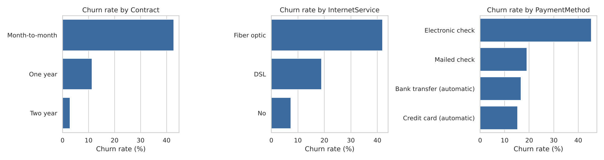
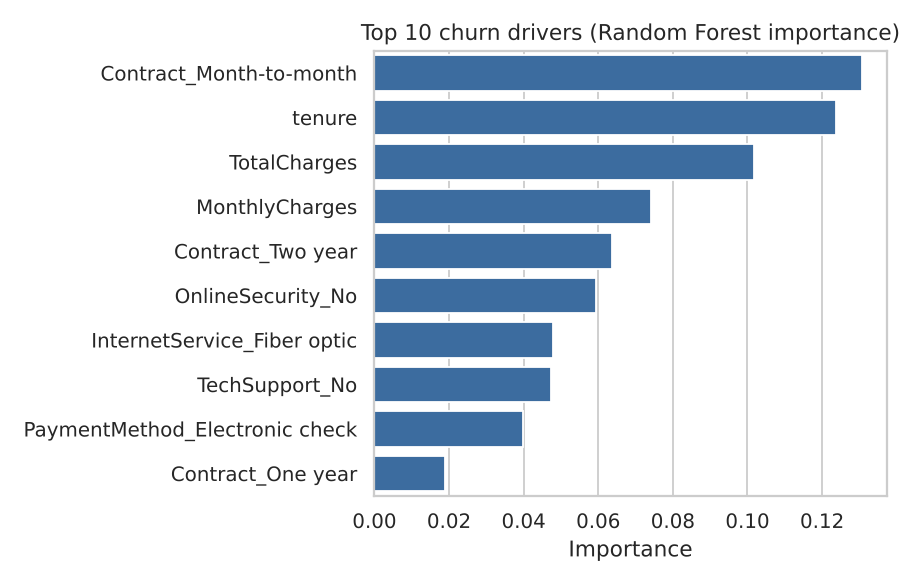

# Telecom Customer Churn Prediction

Predict which telecom customers are likely to churn, explain why, and show how a retention team could use the model.
Built with **Python (Pandas, scikit-learn), SQL (SQLite), Matplotlib/Seaborn** on the public IBM *Telco Customer Churn* dataset (7,043 customers, 21 columns, 26.5% churn).

## What the project does

1. **Cleans** the data: checks for duplicate IDs and converts `TotalCharges` (11 blank values, all brand-new customers with tenure 0) to numeric.
2. **Explores with SQL**: four queries using CTEs, window functions (`RANK`, running totals) and joins - see [`sql/churn_queries.sql`](sql/churn_queries.sql) and [`results/sql_results.md`](results/sql_results.md).
3. **Models**: logistic regression and random forest in a scikit-learn `Pipeline` (scaling + one-hot encoding), stratified 80/20 split, class weights to handle the imbalance.
4. **Explains**: feature importance and segment-level churn charts.
5. **Targets**: ranks customers by predicted risk and measures how many churners a retention campaign would reach.

## Results (1,409 held-out customers)

| Model | Accuracy | Precision | Recall | F1 | ROC-AUC |
|---|---|---|---|---|---|
| Logistic Regression | 0.738 | 0.504 | **0.783** | 0.614 | **0.842** |
| Random Forest | 0.762 | 0.535 | 0.778 | 0.634 | 0.841 |

- **Class imbalance matters:** logistic regression without class weights caught only 55.9% of churners; with `class_weight="balanced"` it catches 78.3%.
- **Top drivers (random forest importance):** month-to-month contract, tenure, total charges, monthly charges, two-year contract.
- **Retention targeting:** contacting the top 20% highest-risk customers (281 of 1,409) reaches 186 of 374 churners (49.7%), a 2.49x lift over random outreach.

### SQL findings

- Month-to-month customers churn at **42.7%**, vs 11.3% on one-year and **2.8%** on two-year contracts.
- Churn is concentrated early: customers in their first 6 months churn at **54.3%**, and the first 12 months account for 53.5% of all churners.
- The riskiest segment is month-to-month + fiber optic: **54.6%** churn across 2,128 customers (about $100K of monthly charges from churned customers in that segment).
- Among internet customers, those without tech support churn at 41.6% vs 15.2% with it. This is an association, not proof that tech support causes retention.




## Project structure

```
data/                put telco_churn.csv here (not committed, see below)
sql/                 churn_queries.sql
src/                 churn_analysis.py
figures/             charts produced by the analysis
results/             metrics.json, sql_results.md
```

## How to run

1. Download the *Telco Customer Churn* CSV (`WA_Fn-UseC_-Telco-Customer-Churn.csv`) from Kaggle.
2. Save it as `data/telco_churn.csv`.
3. Then:

```bash
pip install -r requirements.txt
python src/churn_analysis.py     # runs cleaning, SQL, modelling; writes figures/ and results/
```

## Limitations and next steps

- Default 0.5 decision threshold; a real campaign would tune it to the cost of a missed churner vs a wasted offer.
- No hyperparameter search or cross-validation yet.
- One snapshot of customers: no time dimension, so the model cannot say *when* someone will churn.
